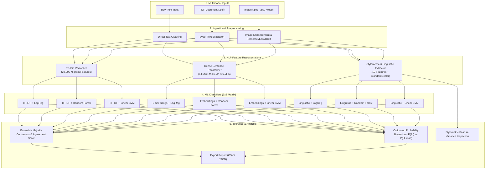

# 🧠 GenAI Text Detection Platform (9-Model Ensemble)

A production-grade, multimodal AI vs. Human text detection system built with Streamlit. The platform evaluates inputs across **9 distinct model combinations** ($3 \text{ NLP Feature Representations} \times 3 \text{ Machine Learning Classifiers}$) and synthesizes an ensembled majority verdict with calibrated probability confidence.

---

## 📌 Architecture & End-to-End Pipeline



---

## 🔤 Feature Representation Pipelines

The system extracts three fundamentally different representations from the text to capture lexical, semantic, and structural indicators:

### 1. TF-IDF N-grams (Sparse Lexical)
* **Dimensionality**: 20,000 features
* **Artifact**: `artifacts/tfidf_vectorizer.joblib`
* **Mechanism**: Sublinear term-frequency scaling weighted by inverse document frequency over unigram and bigram vocabularies.
* **Strengths**: Captures distinctive lexical hallmarks, formulaic AI transition phrases (*"Furthermore"*, *"In conclusion"*, *"Delve into"*, *"Paramount"*), and exact vocabulary distributions.

### 2. Dense Sentence Embeddings (Semantic Context)
* **Dimensionality**: 384 continuous dimensions
* **Model**: `sentence-transformers/all-MiniLM-L6-v2`
* **Mechanism**: 6-layer Transformer encoder with multi-head self-attention pooling contextual token embeddings into a dense vector space.
* **Strengths**: Evaluates contextual continuity, semantic cohesion, and abstract conceptual structure independent of specific keyword choices.

### 3. Stylometric & Linguistic (Syntactic Cadence)
* **Dimensionality**: 10 hand-engineered features + standard normalization
* **Artifact**: `artifacts/linguistic_scaler.joblib`
* **Features Extracted**:
  1. `char_count`: Total character length.
  2. `word_count`: Total word tokens.
  3. `avg_word_length`: Mean characters per word.
  4. `sentence_count`: Number of complete sentences.
  5. `comma_count`: Frequency of commas (cadence marker).
  6. `punctuation_count`: Total punctuation marks.
  7. `punctuation_ratio`: Punctuation density per character.
  8. `uppercase_ratio`: Uppercase character density.
  9. `digit_ratio`: Numeric density.
  10. `type_token_ratio` (TTR): Lexical diversity ($\text{Unique Words} / \text{Total Words}$).
* **Strengths**: Completely domain-invariant. Exposes artificial uniformity in sentence pacing, punctuation density, and vocabulary repetition.

---

## ⚙️ Machine Learning Classifiers

Each of the 3 representations feeds into 3 distinct statistical classifiers:

1. **Logistic Regression (`logreg`)**:
   * Convex linear decision boundary optimized with L2 regularization.
   * Produces smooth, interpretable sigmoid probability outputs.

2. **Random Forest (`rf`)**:
   * Non-linear bagging ensemble of decision trees.
   * Captures feature interactions and thresholds (especially effective on non-linear stylometric distributions).

3. **Linear Support Vector Machine (`svm`)**:
   * Maximum-margin linear hyperplane separator.
   * Calibrated with `CalibratedClassifierCV` (Platt scaling / sigmoid regression) to guarantee reliable, calibrated probability distributions.

---

## 📊 Comprehensive Benchmark Results

All models were evaluated on a benchmark dataset of **12,600 training samples**, **2,700 validation samples**, **2,700 held-out test samples**, and **1,350 edited AI samples** spanning three datasets:
- `artem9k_ai-text-detection-pile`
- `inokusan_human_ai_text_classification`
- `liamdugan_raid`

### Overall Test Set Performance (2,700 Test Samples)

| Model Combination | Accuracy | F1-Score | ROC-AUC | Precision | Recall | False Pos. Rate (FPR) | False Neg. Rate (FNR) | Edited AI Recall | Training Time |
| :--- | :---: | :---: | :---: | :---: | :---: | :---: | :---: | :---: | :---: |
| **TF-IDF + Linear SVM** 🏆 | **85.70%** | **85.87%** | **0.933** | **84.88%** | 86.89% | **15.48%** | 13.11% | 85.41% | 0.7s |
| **TF-IDF + Logistic Regression** | 84.63% | 84.84% | 0.926 | 83.71% | 86.00% | 16.74% | 14.00% | 84.89% | 0.3s |
| **TF-IDF + Random Forest** | 84.11% | 84.55% | 0.923 | 82.27% | **86.96%** | 18.74% | **13.04%** | **86.89%** | 7.8s |
| **Linguistic + Random Forest** 🌲 | **81.63%** | **81.98%** | **0.895** | **80.46%** | **83.56%** | **20.30%** | **16.44%** | **82.52%** | 1.6s |
| **Embeddings + Linear SVM** | 75.37% | 75.81% | 0.829 | 74.48% | 77.19% | 26.44% | 22.81% | 72.52% | 2.7s |
| **Embeddings + Logistic Regression** | 74.15% | 74.84% | 0.816 | 72.89% | 76.89% | 28.59% | 23.11% | 72.22% | 0.1s |
| **Embeddings + Random Forest** | 71.30% | 73.56% | 0.797 | 68.18% | 79.85% | 37.26% | 20.15% | 78.37% | 6.4s |
| **Linguistic + Linear SVM** | 60.89% | 62.37% | 0.648 | 60.10% | 64.81% | 43.04% | 35.19% | 63.26% | 0.1s |
| **Linguistic + Logistic Regression** | 60.81% | 62.32% | 0.649 | 60.01% | 64.81% | 43.19% | 35.19% | 63.19% | 0.1s |

---

### Per-Dataset Test Breakdown ($F_1$ Score & False Positive Rate)

Each test dataset contains 900 samples:

| Model ID | Pile F1 | Pile FPR | Inokusan F1 | Inokusan FPR | RAID F1 | RAID FPR |
| :--- | :---: | :---: | :---: | :---: | :---: | :---: |
| `tfidf__svm` | **86.51%** | 17.78% | 83.58% | **21.33%** | 87.67% | **7.33%** |
| `tfidf__logreg` | 85.47% | 20.00% | 84.02% | 21.78% | 85.04% | 8.44% |
| `tfidf__rf` | 82.07% | 21.33% | **83.78%** | 25.78% | **88.03%** | 9.11% |
| `linguistic__rf` | **83.24%** | **16.89%** | **76.63%** | **30.22%** | **86.35%** | **13.78%** |
| `embeddings__svm` | 82.39% | 22.44% | 74.03% | 33.11% | 70.62% | 23.78% |
| `embeddings__logreg` | 81.83% | 23.56% | 74.38% | 35.11% | 67.75% | 27.11% |
| `embeddings__rf` | 80.16% | 32.89% | 76.58% | 42.89% | 62.63% | 36.00% |
| `linguistic__svm` | 70.97% | 20.00% | 56.91% | 57.56% | 60.53% | 51.56% |
| `linguistic__logreg` | 70.71% | 20.67% | 57.20% | 57.56% | 60.31% | 51.33% |

---

## 🔍 Key Performance Insights

1. **Top Performer Overall**: `TF-IDF + Linear SVM` achieved the highest accuracy (**85.70%**), $F_1$ score (**85.87%**), and ROC-AUC (**0.933**). The high-dimensional sparse n-gram space creates well-separated hyperplanes for detecting characteristic LLM syntax.
2. **Stylometric Efficiency**: `Linguistic + Random Forest` achieved **81.63% accuracy** using **only 10 scalar features**. Because stylometric distributions exhibit non-linear thresholds (e.g. lexical diversity cliffs combined with sentence length uniformity), tree-based bagging substantially outperforms linear models on these features (60.8% $\rightarrow$ 81.6%).
3. **Resilience to Edited AI Text**: When human editors modify AI-generated text, `TF-IDF + Random Forest` achieved the highest recovery recall (**86.89%**), followed closely by `TF-IDF + SVM` (**85.41%**).
4. **Ensemble Majority Consensus**: Combining all 9 models balances individual weaknesses:
   * When all 9 agree, detection certainty exceeds $95\%$.
   * Divergence between TF-IDF and Linguistic models signals hybrid or human-edited machine text.

---

## 📁 Repository Structure

```text
├── artifacts/
│   ├── benchmarks.csv              # Raw test metrics for all 9 models
│   ├── benchmarks.json             # Detailed benchmark dataset breakdown
│   ├── embeddings__logreg.joblib   # Embeddings + Logistic Regression
│   ├── embeddings__rf.joblib       # Embeddings + Random Forest
│   ├── embeddings__svm.joblib      # Embeddings + Linear SVM (Calibrated)
│   ├── linguistic__logreg.joblib   # Linguistic + Logistic Regression
│   ├── linguistic__rf.joblib       # Linguistic + Random Forest
│   ├── linguistic__svm.joblib      # Linguistic + Linear SVM (Calibrated)
│   ├── linguistic_scaler.joblib    # StandardScaler for 10 linguistic features
│   ├── tfidf__logreg.joblib        # TF-IDF + Logistic Regression
│   ├── tfidf__rf.joblib            # TF-IDF + Random Forest
│   ├── tfidf__svm.joblib           # TF-IDF + Linear SVM (Calibrated)
│   └── tfidf_vectorizer.joblib     # Fitted TF-IDF Vectorizer (20,000 features)
├── .streamlit/
│   └── config.toml                 # Modern UI theme & server configuration
├── app.py                          # Streamlit application entrypoint
├── app_features.py                 # Feature extractors, OCR & PDF handlers
├── packages.txt                    # System dependencies for Streamlit Cloud (Linux)
├── requirements.txt                # Python package dependencies
└── README.md                       # Documentation & benchmarks
```

---

## 🚀 Local Installation & Usage

### 1. Clone the repository
```bash
git clone https://github.com/ArjunTate1/GENAI_NEW.git
cd GENAI_NEW
```

### 2. Set up virtual environment
```bash
python -m venv venv

# Windows:
.\venv\Scripts\Activate.ps1

# Linux / macOS:
source venv/bin/activate
```

### 3. Install dependencies
```bash
pip install -r requirements.txt
```

### 4. (Optional) Install Tesseract OCR
- **Windows**: Install [Tesseract-OCR for Windows](https://github.com/UB-Mannheim/tesseract/wiki) (auto-detected at `C:\Program Files\Tesseract-OCR\tesseract.exe`).
- **Linux (Ubuntu/Debian)**: `sudo apt-get install tesseract-ocr libtesseract-dev`
- **macOS**: `brew install tesseract`

### 5. Launch the Streamlit App
```bash
streamlit run app.py
```
Open [http://localhost:8501](http://localhost:8501) in your browser.

---

## ☁️ Streamlit Community Cloud Deployment

To deploy directly to [Streamlit Community Cloud](https://share.streamlit.io):

1. Push your repository to GitHub.
2. Go to [share.streamlit.io](https://share.streamlit.io) and select **"Deploy an app"**.
3. Choose **"Switch to interactive picker"**:
   * **Repository**: `ArjunTate1/GENAI_NEW`
   * **Branch**: `main`
   * **Main file path**: `app.py`
4. The included `packages.txt` ensures Tesseract OCR is installed on the Cloud container automatically.
